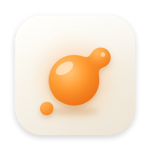
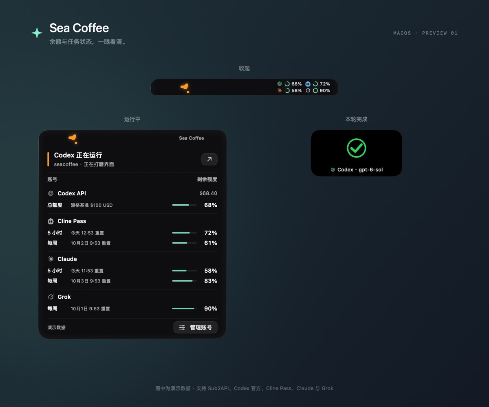

# Sea Coffee

English | [简体中文](README.md)

An AI status island that lives in your MacBook's notch. See at a glance whether Codex, Claude Code, Grok, Cline, Pi, and DSH are working, and how much of each subscription or balance you have left.

Native SwiftUI + AppKit. No Electron, no third-party runtime dependencies.



> The interface is currently in Simplified Chinese. The screenshot above uses demo data.

## Features

- **Unified interface**: warm surfaces and clay accents inspired by open-claude-ui, with light, dark, and system themes. Account shortcuts, per-tool monitoring controls, consistent usage filters, and a fixed save bar keep settings easy to navigate. The notch stays dark.

- **Usage dashboard**: combines CC Switch requests and DSH sessions in one chronological record list, with shared time ranges (today, last 24 hours, last 7 / 14 / 30 days, or all time) and app, provider, and model filters. It keeps known cost, separate request and session counts, tokens, cache hit rate, and detail / provider / model tables; usage trend charts and the heatmap are removed. DSH rows are labelled as sessions, with project, turns, steps, and first-token latency in their details. Their tokens contribute to the combined totals; unavailable costs show “—”. Time filters select whole-session counters by the last prompt time. CC Switch retains about 30 days of request details and older daily rollups; its price table supplies costs, unpriced requests stay out of known cost, and the result is not a bill. Quota and balance trends retain the latest successful snapshot every 15 minutes for about 30 days.

- **Task status**: follows the local session files of Codex, Claude Code, Grok, Cline, Pi (including PI-Desktop, which keeps its sessions in SQLite) and DSH and shows how many conversations are running. When a task finishes, the notch plays a checkmark animation labelled with the agent and model that finished it (for example `Claude Code · claude-opus-5-5`). When an agent asks you a question, the notch pops the same badge with a question mark, labelled with the agent and project that is asking (supported for Claude Code's `AskUserQuestion` and Codex's `request_user_input`). If a Claude Code question stays unanswered, the drop on the left turns violet and pulses, and the expanded panel says it is waiting for you. Failures and interruptions show a text notice.
- **Quotas and balances**, each refreshed independently:

  | Source | What it shows | How it connects |
  |---|---|---|
  | Codex API (Sub2API relay) | Wallet balance, key limit, subscription windows | Site URL + API key |
  | Codex official | 5-hour / weekly limits | Browser sign-in through `codex app-server` |
  | Cline Pass | 5-hour / weekly / monthly | API key, or device-code sign-in |
  | Claude | 5-hour / weekly / Sonnet and Opus weekly | Reuses your Claude Code login |
  | Grok | SuperGrok current period | Reuses your `grok login` session |

- **Privacy first**: only event types, timestamps, project folder names, and model names are read. Conversation content is never stored or uploaded. Logins borrowed from other tools are read-only.
- Quota indicators (small rings when collapsed, bars when expanded): colored like CC Switch — green at 20% or more left, orange below 20%, red when used up, grey when unknown. Unknown data is never shown as 0% or 100%. Resets show as a countdown ("2h30m后重置") and updates as "3 分钟前更新". The quota refresh interval is configurable from 1 to 30 minutes (default 5).
- Settings navigation and account-source controls use sliding highlights, hover feedback, and keyboard focus outlines; the island smoothly adjusts to quota-row changes.
- Usage records build cards and rows as needed to reduce repeated drawing while scrolling. All sources share the same column widths and 20-row pagination.
- Respects both system and app "Reduce motion" settings. On Macs without a notch it appears as a pill at the top of the screen.

## Install

Requires macOS 14+ and the Swift 6 toolchain (Xcode Command Line Tools are enough).

```bash
git clone https://github.com/hbw00111/seacoffee.git
cd seacoffee
bash scripts/build-app.sh
open "dist/Sea Coffee.app"
```

The app is built to `dist/Sea Coffee.app`; drag it to Applications if you like. It lives in the menu bar with no Dock icon. The sparkle icon in the menu bar opens Settings, previews the animations (including a sample question), and quits.

> The app is not notarized by Apple. If macOS says it cannot verify the developer, right-click the app in Finder and choose Open.

## Droppy extension

Sea Coffee also runs inside Droppy 16.0.1+: a Shelf dashboard shows quotas and tasks, a persistent live activity shows per-account quota rings and percentages alongside task status, including while idle, and HUDs announce completion, questions and failures. It reuses the same monitoring and account code without launching the standalone app.

Run `bash scripts/build-droplet.sh`, then choose `dist/SeaCoffeeDroplet.droplet` under **Droplet Store → Local droplets**. Approve the local build and select Sea Coffee on the Shelf widgets page. The gear opens account and monitoring settings, sharing the standalone preferences and credential storage. Quit the standalone app to avoid duplicate polling. The embedded settings cannot quit Droppy or change its login item.

Local unsigned droplets require approval on each host launch; replacing a loaded build requires restarting Droppy. Built-in music, meetings and recording take priority over its compact live activity. Quotas poll at the configured interval (default 5 minutes; Claude / Grok at least 120 seconds apart), with additional refreshes on task completion; this is not second-by-second streaming. Swift 6.2+ is required. The build pins DroppyKit v1.20.1 and prepares an isolated macro compatibility copy for Command Line Tools. See [extension development](Droplet/README.md).

## Usage

Each account card includes usage details: wallet balance, all returned quota windows, remaining percentages, reset times, and the last successful update. Stale data is marked explicitly; unavailable usage is not shown as zero.

Saved Codex API and Cline API keys show a masked summary in their fields. Enter a new key to replace one; leaving the edit buffer empty preserves the saved key.

Open **Settings** and connect the sources you use:

- **Codex API**: enter your Sub2API site URL, API key, and the balance that counts as full, then click "保存并刷新" (Save and refresh). Only `GET /v1/usage` is called; no model requests are sent. After each top-up, the baseline moves to the new balance automatically. A balance already above the old baseline also corrects it on refresh.
- **Codex official**: switch the connection mode and click "连接官方账号" (Connect official account). A separate Codex home directory is used, so your existing Codex login is untouched.
- **Cline Pass**: create an API key at [app.cline.bot](https://app.cline.bot) and paste it in, or sign in with a device code in your browser.
- **Claude**: sign in with `claude` in a terminal first, then click "连接 Claude Code" (Connect Claude Code).
- **Grok**: run `grok login` first, then click "连接 Grok" (Connect Grok). After that, an expired token is refreshed by the Grok CLI automatically.
- **Task status**: all six agents are followed by default; each can be turned off. When Pi uses Cline Pass, the completion label names the channel and the usage counts toward the Cline quota.

To start Sea Coffee when you log in, turn on "开机自启" (Launch at login) under "外观与交互" (Appearance and interaction) in Settings; it takes effect immediately.

Hover over the top of the screen to expand; move away to collapse. "固定展开" (Keep expanded) in the menu bar keeps it open, and "预览动画" (Preview animation) and "预览提问提示" (Preview question) show the effects without touching real data.

## Security and privacy

- Credentials that Sea Coffee saves itself (Sub2API key, Cline login or key) live in `~/Library/Application Support/SeaIsland/credentials.json` with `0600` permissions and atomic writes. A file is used instead of the Keychain because, without an Apple Developer ID signature, Keychain grants are tied to each build's binary hash and are lost on every rebuild.
- Claude and Grok tokens are read-only, kept in memory, and never refreshed or written back, so the original tools stay signed in. When a token expires, only the original CLI renews it: Grok runs `grok models` once; for Claude, Sea Coffee never starts Claude Code in the background: it keeps the last quota and says the login expired until you next use Claude Code, which renews itself. Only when you click "重新读取" (Re-read) does it open Claude Code's `/usage` screen once in a dedicated folder and read the quota from it (no tools, no hooks, no prompt sent, transcript removed afterwards).
- No request follows redirects, and credentials are never written to logs or UserDefaults.
- The Claude, Grok, and Cline quota endpoints are the ones their websites or CLIs use, not stable public APIs. If a format changes, Sea Coffee keeps the last value and shows a notice rather than a wrong number.

Data sources, protocols, and implementation details are documented (in Chinese) in [docs/how-it-works.md](docs/how-it-works.md); current status, roadmap, and known issues are in [docs/progress.md](docs/progress.md).

## Development

```bash
swift run IslandChecks                   # core checks: parsers, state machines, credential file
bash scripts/check-account-isolation.sh  # sources never overwrite each other's quota or status
bash scripts/check-credentials.sh        # credential store and legacy Keychain import (isolated test item)
```

- `Sources/IslandCore`: UI-independent logic, including quota parsers, session state machines, and the credential file.
- `Sources/SeaCoffee`: interface, overlay panel, networking, and account integrations.
- The checks do not need full Xcode and never touch the network or your real credentials.

Issues and pull requests are welcome; see [CONTRIBUTING.md](CONTRIBUTING.md).

## Acknowledgements

- [CodexBar](https://github.com/steipete/CodexBar) (MIT): research into provider quota endpoints, and the embedded provider icons (`ProviderIcon-*.svg`).
- [NotchAI](https://github.com/Winnie-Wong2026/NotchAI): ideas for the AppKit overlay and local monitoring.
- [Sub2API](https://github.com/Wei-Shaw/sub2api), [Codex App Server](https://developers.openai.com/codex/app-server), [Cline SDK](https://github.com/cline/cline): API fields and sign-in protocols.

Codex, Claude, Cline, and Grok names and logos belong to OpenAI, Anthropic, Cline, and xAI; DSH belongs to DeepSeek. This project is not affiliated with any of them; the logos only identify each source.

## License

[MIT](LICENSE)
